<div align="center">

# ⚛️ DHRUB CHATTERJEE
### *Chemical Engineer · Scientific Machine Learning · Autonomous Discovery Systems*

[-Equivariant+Graph+Neural+Networks+%7C+SchNet;Input+Convex+Neural+Networks+(ICNN)+for+Helmholtz+Energy;Industrial+RTO+%2B+Digital+Twins+(ISA-95+%2F+IEC+62443))](https://git.io/typing-svg)

<br/>

[](https://linkedin.com/in/dhrub-chatterjee-b68556341/)
[](mailto:dhrubchatterjee16@gmail.com)
[](https://github.com/dhrubchatterjee16-lang)
[]()

</div>

---

### 🧬 Scientific Engineering Profile

I conduct research and software engineering at the convergence of **Chemical Engineering**, **Scientific Machine Learning (SciML)**, and **Autonomous Discovery Robotics**. 

Rather than treating deep learning as unconstrained curve-fitting, my work embeds **physical conservation laws, thermodynamic stability criteria, and geometric coordinate symmetries** directly into computational neural graphs.

```
      Classical Thermodynamics             Geometric Deep Learning              Closed-Loop Automation
 ┌───────────────────────────────┐     ┌───────────────────────────────┐     ┌──────────────────────────────┐
 │ • Helmholtz Free Energy (ICNN)│     │ • SE(3) Equivariant GNNs      │     │ • Multi-Fidelity Bayesian Opt│
 │ • CAPE-OPEN / Peng-Robinson   │ ──> │ • Molecular Force Fields      │ ──> │ • Opentrons Robotic Control  │
 │ • ISA-95 Industrial Twins     │     │ • Polymer Topological Graphs  │     │ • Self-Driving Catalyst Labs │
 └───────────────────────────────┘     └───────────────────────────────┘     └──────────────────────────────┘
```

---

### 🏛️ Research Architecture & Project Taxonomy

```mermaid
flowchart TD
    classDef core fill:#1e1e2e,stroke:#6c5ce7,stroke-width:2px,color:#fff;
    classDef flag fill:#0f3460,stroke:#00fff5,stroke-width:2px,color:#fff;
    classDef domain fill:#16213e,stroke:#4ecca3,stroke-width:1px,color:#fff;
    classDef tool fill:#1a1a2e,stroke:#e94560,stroke-width:1px,color:#fff;

    Root["<b>First-Principles Chemical Engineering & Physics</b>"]:::core

    Root --> P1["<b>1. Thermodynamics & Industrial Systems</b>"]:::core
    Root --> P2["<b>2. Materials Informatics & Molecular AI</b>"]:::core
    Root --> P3["<b>3. Autonomous Discovery & Clean Energy</b>"]:::core
    Root --> P4["<b>4. Domain-Adapted Scientific LLMs</b>"]:::core

    P1 --> F1["<b>DeepRefine</b><br/>Level 3 RTO & ISA-95 Twin"]:::flag
    P1 --> F2["<b>pinn-thermo</b><br/>ICNN Helmholtz Free Energy"]:::flag
    P1 --> F3["<b>corrosense-AI</b><br/>NumPy Nernst-Planck"]:::flag
    P1 --> D1["Value-Chain-Investment-Model"]:::domain

    P2 --> F4["<b>chem-scientist-ai</b><br/>SE(3) SchNet Force Fields"]:::flag
    P2 --> F5["<b>molgenie</b><br/>Grammar Retrosynthesis"]:::flag
    P2 --> D2["PolymerGenesis (D-MPNN)"]:::domain
    P2 --> D3["orbital-molprop (DFT)"]:::domain
    P2 --> D4["proteinbio & enzyme-gen"]:::domain

    P3 --> F6["<b>auto-catalyst-2.0</b><br/>BoTorch + Opentrons SDL"]:::flag
    P3 --> D5["green-hydrogen-generation"]:::domain
    P3 --> D6["GREEN_HYDROGEN_generation- (TEA)"]:::domain
    P3 --> D7["solid-state-electrolyte & battery PINNs"]:::domain

    P4 --> T1["dapt-llm-domain-adapter"]:::tool
    P4 --> T2["strict-structured-json-extractor"]:::tool
    P4 --> T3["AGENTIC_RAG_LAB & DPO-TruthfulLLM"]:::tool
```



---

## 🚀 Flagship Research Deployments

<table>
<tr>
<td width="50%" valign="top">

### ⚡ [DeepRefine](https://github.com/dhrubchatterjee16-lang/DeepRefine)
[](https://github.com/dhrubchatterjee16-lang/DeepRefine/actions)
[](https://github.com/dhrubchatterjee16-lang/DeepRefine/releases/tag/v1.0.0)
[](https://github.com/dhrubchatterjee16-lang/DeepRefine/blob/main/LICENSE)

**Industrial Level 3 Supervisory RTO & Digital Twin Reference Architecture**
* Bridges ISA-95 / IEC 62443 industrial control hierarchies with Physics-Informed Neural Networks.
* Real-time optimization (RTO) resolving stiff differential-algebraic equations (DAEs) under `<100ms` cycle constraints.
* Integrated API 670 machinery vibration diagnostics and MPC supervisory control.
<br/>
<code>PyTorch</code> <code>PINNs</code> <code>ISA-95</code> <code>Process Control</code> <code>MPC</code>

</td>
<td width="50%" valign="top">

### 🧪 [auto-catalyst-2.0](https://github.com/dhrubchatterjee16-lang/auto-catalyst-2.0)
[](https://github.com/dhrubchatterjee16-lang/auto-catalyst-2.0/actions)
[](https://github.com/dhrubchatterjee16-lang/auto-catalyst-2.0/releases/tag/v1.0.0)
[](https://github.com/dhrubchatterjee16-lang/auto-catalyst-2.0/blob/main/LICENSE)

**Autonomous AI Self-Driving Lab Platform for Heterogeneous Catalysis**
* Closed-loop active learning orchestrating multi-fidelity Bayesian optimization via **BoTorch & Ax**.
* Constrained multi-objective acquisition ($q\text{NEHVI}$) balancing activity, selectivity, and catalyst coking kinetics.
* Fluidics automation control scripts designed for **Opentrons OT-2** liquid-handling robotics.
<br/>
<code>BoTorch</code> <code>Active Learning</code> <code>Opentrons</code> <code>Bayesian Opt</code>

</td>
</tr>
<tr>
<td width="50%" valign="top">

### 📐 [pinn-thermo](https://github.com/dhrubchatterjee16-lang/pinn-thermo)
[](https://github.com/dhrubchatterjee16-lang/pinn-thermo/actions)
[](https://colab.research.google.com/github/dhrubchatterjee16-lang/pinn-thermo/blob/main/notebooks/quickstart.ipynb)
[](https://github.com/dhrubchatterjee16-lang/pinn-thermo/blob/main/LICENSE)

**Input Convex Neural Network (ICNN) Helmholtz Free Energy Engine**
* Formulates thermodynamically consistent surrogates: strictly convex in volume (mechanical stability: $\kappa_T > 0$) and concave in temperature ($C_v > 0$).
* Enforces $C^2$-continuity via smooth activations for exact autograd state evaluation ($P = -\partial A/\partial V$).
* Validated against Peng-Robinson (PR-EOS) and PC-SAFT baselines.
<br/>
<code>ICNN</code> <code>Thermodynamics</code> <code>CAPE-OPEN</code> <code>SciML</code>

</td>
<td width="50%" valign="top">

### 🔮 [chem-scientist-ai](https://github.com/dhrubchatterjee16-lang/chem-scientist-ai)
[](https://github.com/dhrubchatterjee16-lang/chem-scientist-ai/actions)
[](https://github.com/dhrubchatterjee16-lang/chem-scientist-ai/releases/tag/v1.0.0)
[](https://github.com/dhrubchatterjee16-lang/chem-scientist-ai/blob/main/LICENSE)

**SE(3)-Equivariant Continuous-Filter Molecular Intelligence**
* Geometric Graph Neural Network enforcing translational and rotational equivariance over 3D coordinates.
* Predicts invariant scalar potentials (energy) and equivariant vector force fields ($\mathbf{F} = -\nabla_{\mathbf{r}} E$).
* Evaluated against standard atomistic benchmarks (QM9, OC20).
<br/>
<code>Geometric DL</code> <code>SE(3) Equivariance</code> <code>SchNet</code> <code>PyG</code>

</td>
</tr>
<tr>
<td width="50%" valign="top">

### ⚙️ [corrosense-AI](https://github.com/dhrubchatterjee16-lang/corrosense-AI)
[](https://github.com/dhrubchatterjee16-lang/corrosense-AI/actions)
[](https://github.com/dhrubchatterjee16-lang/corrosense-AI/releases/tag/v1.0.0)
[](https://github.com/dhrubchatterjee16-lang/corrosense-AI/blob/main/LICENSE)

**Electrochemical Nernst-Planck & Flow Corrosion Intelligence from Scratch**
* Implemented end-to-end in pure **NumPy** with zero deep learning framework abstractions (custom autograd, Adam, BatchNorm, LeakyReLU).
* Models multiphase Nernst-Planck ionic electrodiffusion coupled with Butler-Volmer boundary kinetics.
<br/>
<code>Pure NumPy</code> <code>Autograd from Scratch</code> <code>Electrochemistry</code>

</td>
<td width="50%" valign="top">

### 🧬 [molgenie](https://github.com/dhrubchatterjee16-lang/molgenie)
[](https://github.com/dhrubchatterjee16-lang/molgenie/actions)
[](https://github.com/dhrubchatterjee16-lang/molgenie/releases/tag/v1.0.0)
[](https://github.com/dhrubchatterjee16-lang/molgenie/blob/main/LICENSE)

**Grammar-Guaranteed Generative AI & Retrosynthesis Feasibility Engine**
* Constrained molecular generation engine guaranteeing 100% valence validity via context-free SMILES grammars.
* Evaluates retrosynthetic accessibility (SAScore / SCScore) and reaction template compatibility.
<br/>
<code>Generative AI</code> <code>Retrosynthesis</code> <code>RDKit</code> <code>Cheminformatics</code>

</td>
</tr>
</table>

---

## 📚 Complete Research & Engineering Directory

<details open>
<summary><b>1. Thermodynamics, Process Systems & Industrial Automation (Click to expand)</b></summary>
<br/>

| Repository | Focus & Domain Formulation | Verification & Standards |
|---|---|---|
| [**DeepRefine**](https://github.com/dhrubchatterjee16-lang/DeepRefine) | Level 3 Supervisory RTO & Industrial Digital Twin Architecture | `CI: Passing` · `v1.0.0` · `Citable` · `MIT` |
| [**pinn-thermo**](https://github.com/dhrubchatterjee16-lang/pinn-thermo) | Input Convex Neural Network (ICNN) Helmholtz Free Energy | `CI: Passing` · `v1.0.0` · `Colab Demo` · `Citable` |
| [**corrosense-AI**](https://github.com/dhrubchatterjee16-lang/corrosense-AI) | Nernst-Planck Flow Corrosion from Scratch in NumPy | `CI: Passing` · `v1.0.0` · `Citable` · `MIT` |
| [**Value-Chain-Investment-Model**](https://github.com/dhrubchatterjee16-lang/Value-Chain-Investment-Model-Design) | Chemical Manufacturing Capital Allocation & Process Economics | `Operations Research` · `MIT` |

</details>

<details open>
<summary><b>2. Materials Informatics, Molecular AI & Quantum Chemistry</b></summary>
<br/>

| Repository | Focus & Domain Formulation | Verification & Standards |
|---|---|---|
| [**chem-scientist-ai**](https://github.com/dhrubchatterjee16-lang/chem-scientist-ai) | SE(3)-Equivariant Continuous-Filter SchNet GNNs | `CI: Passing` · `v1.0.0` · `Citable` · `MIT` |
| [**molgenie**](https://github.com/dhrubchatterjee16-lang/molgenie) | Grammar-Guaranteed Generative Chemistry & Retrosynthesis | `CI: Passing` · `v1.0.0` · `Citable` · `MIT` |
| [**PolymerGenesis**](https://github.com/dhrubchatterjee16-lang/PolymerGenesis) | D-MPNN Graph Neural Networks for Polymer Properties ($T_g$) | `Citable` · `PyTorch Geometric` · `MIT` |
| [**orbital-molprop**](https://github.com/dhrubchatterjee16-lang/orbital-molprop) | Deep Learning Surrogates for Frontier Orbitals (HOMO/LUMO) | `Quantum ML` · `Citable` · `MIT` |
| [**glassbox-molecular-ai**](https://github.com/dhrubchatterjee16-lang/glassbox-molecular-ai) | Explainable AI (XAI) Integrated Gradients on Molecular Graphs | `Interpretability` · `Citable` · `MIT` |
| [**proteinbio**](https://github.com/dhrubchatterjee16-lang/proteinbio) | Transformer Architecture for Sequence Contact Maps | `Bioinformatics` · `Citable` · `MIT` |
| [**enzyme-gen**](https://github.com/dhrubchatterjee16-lang/enzyme-gen) | ESM-2 Zero-Shot Mutational Engine & ProteinGym Benchmarks | `Biocatalysis` · `Citable` · `MIT` |

</details>

<details open>
<summary><b>3. Autonomous Discovery, Clean Energy & Electrochemistry</b></summary>
<br/>

| Repository | Focus & Domain Formulation | Verification & Standards |
|---|---|---|
| [**auto-catalyst-2.0**](https://github.com/dhrubchatterjee16-lang/auto-catalyst-2.0) | Multi-Fidelity Bayesian Optimization & Opentrons Robotics | `CI: Passing` · `v1.0.0` · `Citable` · `MIT` |
| [**green-hydrogen-generation**](https://github.com/dhrubchatterjee16-lang/green-hydrogen-generation) | Dynamic Multiphysics & Electrochemical PEM Simulator | `Butler-Volmer` · `Citable` · `MIT` |
| [**GREEN_HYDROGEN_generation-**](https://github.com/dhrubchatterjee16-lang/GREEN_HYDROGEN_generation-) | Techno-Economic Analysis (TEA) & LCOH Optimization | `Energy Economics` · `Citable` · `MIT` |
| [**solid-state-electrolyte**](https://github.com/dhrubchatterjee16-lang/solid-state-electrolyte) | Crystal Graph Convolution (CGCNN) for Ionic Transport | `Battery Informatics` · `Citable` · `MIT` |
| [**energy-storage-pinn**](https://github.com/dhrubchatterjee16-lang/energy-storage-pinn) | Physics-Informed Neural Network Battery Thermal Runaway | `SciML` · `Citable` · `MIT` |
| [**des-solvent-lithium**](https://github.com/dhrubchatterjee16-lang/des-solvent-lithium) | Deep Eutectic Solvent Screening for Li-Battery Recycling | `Green Chemistry` · `Citable` · `MIT` |
| [**opticat-ai**](https://github.com/dhrubchatterjee16-lang/opticat-ai) | In-situ Optical & Spectral Characterization of Catalysts | `Computer Vision` · `Citable` · `MIT` |

</details>

<details open>
<summary><b>4. Scientific Foundation Models, Agents & Lab Automation</b></summary>
<br/>

| Repository | Focus & Domain Formulation | Verification & Standards |
|---|---|---|
| [**dapt-llm-domain-adapter**](https://github.com/dhrubchatterjee16-lang/dapt-llm-domain-adapter) | Continued Pre-Training on Chemical Literature & Standards | `Unsloth` · `Continued Pre-Training` · `MIT` |
| [**strict-structured-json-extractor**](https://github.com/dhrubchatterjee16-lang/strict-structured-json-extractor) | QLoRA Grammar-Constrained JSON Extraction for Wet-Labs | `Outlines` · `Pydantic Validated` · `MIT` |
| [**AGENTIC_RAG_LAB**](https://github.com/dhrubchatterjee16-lang/AGENTIC_RAG_LAB) | Multi-Agent Patent & Chemical Synthesis Retrieval | `LangChain` · `Hybrid Search` · `MIT` |
| [**DPO-TruthfulLLM**](https://github.com/dhrubchatterjee16-lang/DPO-TruthfulLLM) | Direct Preference Optimization for Scientific Factuality | `TRL` · `Hallucination Suppression` · `MIT` |
| [**multimodal-chart-vision-llm**](https://github.com/dhrubchatterjee16-lang/multimodal-chart-vision-llm) | Multimodal VLM for Digitizing Scientific Spectra & Charts | `Qwen2-VL` · `OpenCV Extraction` · `MIT` |

</details>

<details open>
<summary><b>5. Open-Source Ecosystem Tracking & Upstream Exploration</b></summary>
<br/>

| Upstream Package | Focus & Relationship | Upstream Link |
|---|---|---|
| [**deepchem**](https://github.com/dhrubchatterjee16-lang/deepchem) | Deep learning for drug discovery, quantum chemistry, and materials | [deepchem/deepchem](https://github.com/deepchem/deepchem) |
| [**mdanalysis**](https://github.com/dhrubchatterjee16-lang/mdanalysis) | Trajectory and topology analysis library for molecular dynamics simulations | [MDAnalysis/mdanalysis](https://github.com/MDAnalysis/mdanalysis) |
| [**numpy**](https://github.com/dhrubchatterjee16-lang/numpy) | Fundamental array computing framework; studying internal C-API vectorization | [numpy/numpy](https://github.com/numpy/numpy) |
| [**xsf**](https://github.com/dhrubchatterjee16-lang/xsf) | Modern high-performance special functions library (SciPy foundation) | [scipy/xsf](https://github.com/scipy/xsf) |
| [**best-of-atomistic-machine-learning**](https://github.com/dhrubchatterjee16-lang/best-of-atomistic-machine-learning) | Curated tracking of benchmarks and architectures in atomistic ML | [virtual-materials/baml](https://github.com/virtual-materials/best-of-atomistic-machine-learning) |

</details>

---

### 💻 Computational Arsenal & Tech Stack

<div align="center">

| Domain | Technologies & Frameworks |
|---|---|
| **Scientific Computing & ML** |       |
| **Cheminformatics & Materials** |     |
| **Chemical Engineering & Systems** |     |
| **Engineering & Deployment** |      |

</div>

---

### 📊 GitHub Activity Matrix

<div align="center">


<br/>


</div>

---

<div align="center">

> *"Where others see data distributions, physics sees conservation laws."*

**Open for Research Collaborations & Scientific Machine Learning Engineering Roles**
<br/>
[📫 Send an Email](mailto:dhrubchatterjee16@gmail.com) · [💼 LinkedIn Profile](https://linkedin.com/in/dhrub-chatterjee-b68556341/)

</div>
