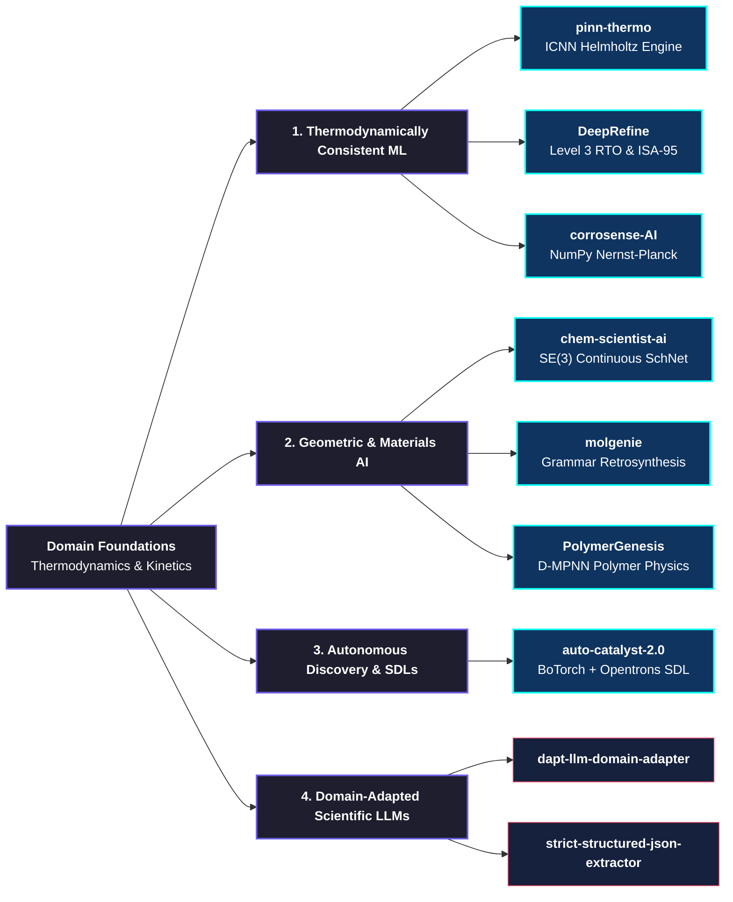

<div align="center">

# ⚛️ DHRUB CHATTERJEE
### *Chemical Engineer · Scientific Machine Learning · Autonomous Discovery*

[-Equivariant+Graph+Neural+Networks+%7C+SchNet;Input+Convex+Neural+Networks+(ICNN)+for+Helmholtz+Energy;Industrial+RTO+%2B+Digital+Twins+(ISA-95+%2F+IEC+62443))](https://git.io/typing-svg)

<br/>

[](https://linkedin.com/in/dhrub-chatterjee-b68556341/)
[](mailto:dhrubchatterjee16@gmail.com)
[](https://github.com/dhrubchatterjee16-lang)
[]()

</div>

---

### 🧬 Executive Profile

I engineer at the intersection of **Chemical Process Engineering** and **Foundational Scientific AI**. Rather than treating machine learning as an unconstrained black-box, my research and architectures enforce physical conservation laws, thermodynamic stability criteria, and geometric symmetries directly into computational graphs.

```
      Classical Thermodynamics             Geometric Deep Learning              Closed-Loop Automation
 ┌───────────────────────────────┐     ┌───────────────────────────────┐     ┌──────────────────────────────┐
 │ • Helmholtz Free Energy (ICNN)│     │ • SE(3) Equivariant GNNs      │     │ • Multi-Fidelity Bayesian Opt│
 │ • CAPE-OPEN / Peng-Robinson   │ ──> │ • Molecular Force Fields      │ ──> │ • Opentrons Robotic Control  │
 │ • ISA-95 Industrial Twins     │     │ • Polymer Topological Graphs  │     │ • Self-Driving Catalyst Labs │
 └───────────────────────────────┘     └───────────────────────────────┘     └──────────────────────────────┘
```

---

### 🏛️ Research & Architecture Taxonomy



---

## 🚀 Flagship Deployments

<table>
<tr>
<td width="50%" valign="top">

### ⚡ [DeepRefine](https://github.com/dhrubchatterjee16-lang/DeepRefine)
**Industrial Level 3 Supervisory RTO & Digital Twin Testbed**
* Bridges ISA-95 / IEC 62443 manufacturing automation with Physics-Informed Neural Networks.
* Real-time optimization (RTO) resolving stiff differential-algebraic equations (DAEs) under `<100ms` cycle constraints.
* Built-in API 670 machinery vibration diagnostics and MPC supervisory control.
<br/>
<code>PyTorch</code> <code>PINNs</code> <code>ISA-95</code> <code>Process Control</code> <code>MPC</code>

</td>
<td width="50%" valign="top">

### 🧪 [auto-catalyst-2.0](https://github.com/dhrubchatterjee16-lang/auto-catalyst-2.0)
**Autonomous Self-Driving Lab (SDL) for FCC Catalysts**
* Closed-loop active learning orchestrating multi-fidelity Bayesian optimization via **BoTorch & Ax**.
* Constrained multi-objective acquisition ($q\text{NEHVI}$) balancing activity, selectivity, and catalyst coking kinetics.
* Automated fluidics control scripts designed for **Opentrons OT-2** liquid-handling robotics.
<br/>
<code>BoTorch</code> <code>Active Learning</code> <code>Opentrons</code> <code>Bayesian Opt</code>

</td>
</tr>
<tr>
<td width="50%" valign="top">

### 📐 [pinn-thermo](https://github.com/dhrubchatterjee16-lang/pinn-thermo)
**ICNN Helmholtz Free Energy & CAPE-OPEN Engine**
* Formulates thermodynamically consistent surrogates: convex in volume (mechanical stability: $\kappa_T > 0$) and concave in temperature ($C_v > 0$).
* Enforces $C^2$-continuity using GELU/SiLU activations for exact autograd state evaluation ($P = -\partial A/\partial V$).
* Validated against Peng-Robinson (PR-EOS) and PC-SAFT baselines.
<br/>
<code>ICNN</code> <code>Thermodynamics</code> <code>CAPE-OPEN</code> <code>SciML</code>

</td>
<td width="50%" valign="top">

### 🔮 [chem-scientist-ai](https://github.com/dhrubchatterjee16-lang/chem-scientist-ai)
**SE(3)-Equivariant Continuous-Filter Molecular Intelligence**
* Geometric Graph Neural Network enforcing translational and rotational equivariance over 3D Cartesian coordinates.
* Predicts invariant scalar potentials (energy) and equivariant vector force fields ($\mathbf{F} = -\nabla_{\mathbf{r}} E$).
* Evaluated against standard atomistic benchmarks (QM9, OC20).
<br/>
<code>Geometric DL</code> <code>SE(3) Equivariance</code> <code>SchNet</code> <code>PyG</code>

</td>
</tr>
<tr>
<td width="50%" valign="top">

### ⚙️ [corrosense-AI](https://github.com/dhrubchatterjee16-lang/corrosense-AI)
**Electrochemical Flow Corrosion Intelligence from Scratch**
* Implemented end-to-end in pure **NumPy** with zero framework abstractions (custom autograd, Adam, BatchNorm, LeakyReLU).
* Models multiphase Nernst-Planck ionic transport and electrochemical Butler-Volmer boundary kinetics.
<br/>
<code>Pure NumPy</code> <code>Autograd from Scratch</code> <code>Electrochemistry</code>

</td>
<td width="50%" valign="top">

### 🧬 [molgenie](https://github.com/dhrubchatterjee16-lang/molgenie)
**Grammar-Guaranteed Generative AI & Retrosynthesis**
* Constrained molecular generation engine guaranteeing 100% valence validity via context-free SMILES grammars.
* Evaluates retrosynthetic accessibility (SAScore / SCScore) and reaction template compatibility.
<br/>
<code>Generative AI</code> <code>Retrosynthesis</code> <code>RDKit</code> <code>Cheminformatics</code>

</td>
</tr>
</table>

---

### 💻 Computational Arsenal & Tech Stack

<div align="center">

| Domain | Technologies & Frameworks |
|---|---|
| **Scientific Computing & ML** |       |
| **Cheminformatics & Molecular** |     |
| **Chemical Engineering & Systems** |     |
| **Engineering & Deployment** |      |

</div>

---

### 📊 GitHub Activity Matrix

<div align="center">


<br/>


</div>

---

<div align="center">

> *"Where others see data distributions, physics sees conservation laws."*

**Open for Research Collaborations & Scientific ML Engineering Roles**
<br/>
[📫 Send an Email](mailto:dhrubchatterjee16@gmail.com) · [💼 LinkedIn Profile](https://linkedin.com/in/dhrub-chatterjee-b68556341/)

</div>
