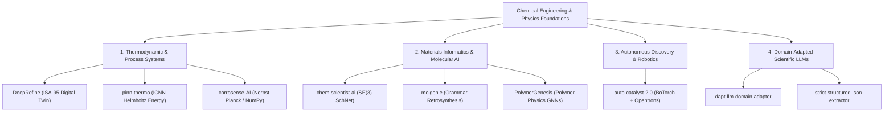

# Dhrub Chatterjee
### Chemical Engineer · Scientific Machine Learning · Autonomous Discovery

I bridge **first-principles Chemical Engineering** with **Modern Scientific AI**. My work focuses on thermodynamically consistent neural architectures (ICNNs, PINNs), geometric deep learning on molecular manifolds (SE(3) equivariant GNNs), and closed-loop Bayesian optimization for self-driving discovery laboratories.

---

## 🏛️ Research & Engineering Taxonomy

---

## 🚀 Flagship Projects

### 1. [DeepRefine](https://github.com/dhrubchatterjee16-lang/DeepRefine)
> **Open Industrial Reference Architecture for Level 3 RTO, Digital Twins, and API 670 Diagnostics**
* Bridges ISA-95 / IEC 62443 industrial control layers with Physics-Informed Neural Networks and Real-Time Optimization (RTO).
* Built for stiff differential-algebraic process dynamics (CSTRs, distillation trains) with sub-100ms inference latency.

### 2. [auto-catalyst-2.0](https://github.com/dhrubchatterjee16-lang/auto-catalyst-2.0)
> **Autonomous AI Self-Driving Lab Platform for FCC Catalyst Discovery**
* Multi-fidelity Bayesian optimization via BoTorch/Ax paired with chemical digital twins and Opentrons liquid-handling automation.
* Constrained multi-objective acquisition balancing catalytic activity, selectivity, and deactivation.

### 3. [pinn-thermo](https://github.com/dhrubchatterjee16-lang/pinn-thermo)
> **Input Convex Neural Networks (ICNN) for Helmholtz Free Energy & CAPE-OPEN Engine**
* Formulates thermodynamically consistent neural surrogates enforcing strict convexity over volume ($\\kappa_T > 0$) and concavity over temperature ($C_v > 0$).
* Validated against Peng-Robinson (PR-EOS) and PC-SAFT benchmarks with $C^2$-continuous activations.

### 4. [chem-scientist-ai](https://github.com/dhrubchatterjee16-lang/chem-scientist-ai)
> **SE(3)-Equivariant Continuous-Filter Graph Neural Networks for Molecular Intelligence**
* Geometric deep learning for invariant molecular energy prediction and equivariant force-field vector extraction.
* Evaluated against standard chemical benchmarks (QM9, OC20).

### 5. [corrosense-AI](https://github.com/dhrubchatterjee16-lang/corrosense-AI)
> **Electrochemical Nernst-Planck & Flow Corrosion Intelligence from Scratch**
* Implemented end-to-end in pure NumPy (forward/backward autograd, Adam, BatchNorm, LeakyReLU) to model corrosion degradation without black-box framework abstractions.

---

## 🛠️ Tech Stack & Domain Tooling
* **Domain Physics & Modeling:** DWSIM, CAPE-OPEN, CoolProp, RDKit, Open Babel, MDAnalysis, DeepChem.
* **Scientific ML & Optimization:** PyTorch, BoTorch, GPyTorch, PyTorch Geometric, JAX/Diffrax.
* **Industrial & Systems:** ISA-95 / IEC 62443 architecture, OPC-UA, Docker, FastAPI, Streamlit.
